# Phase 2 EDA: Idea 3 (severity) and Idea 4 (the lockdown test)

**Script:** `processing/phase2_ideas.py`. It reruns from scratch in a few seconds. Run it with the project venv: `python processing/phase2_ideas.py`.
**Inputs:** `data/clean/traffic_national_monthly_clean.csv` (primary). The raw workbook `Datas/hospitalisation_injury_publication_sep2023.xlsx` is used for reconciliation only. Also read: `supp_population_age.csv` (ABS ERP) and `state_by_road_user.csv`.
**Outputs:** 12 CSVs in `data/clean/` (`idea3_*`, `idea4_*`), 12 PNGs in `processing/eda_figures/phase2/`, plus `processing/phase2_validation.csv`, `processing/phase2_key_numbers.csv` (100 quotable numbers, each tied to a source CSV) and `processing/phase2_run_log.txt`.
**Not touched:** `processing/clean_data.py`, the existing `data/clean/*.csv`, `website/`.

Every number in this report is copied from the run log or from `phase2_key_numbers.csv`.

## 1. Methods

| Rule | What the script does |
|---|---|
| P1 Burden shares | **2016-2021 only.** The bed-day method changed on 1 July 2015 (ICD-10-AM 9th ed.). Share of cases uses `cases_incl_died`. Share of bed days uses `bed_days` **as published, which includes died bed days**. With `bed_days_excl_died` the shares barely move (pedestrians stay at 13.1%, cyclists 11.1% becomes 11.2%). |
| P2 Died in care per 1,000 | `1000 x died_cases / cases_incl_died`, **2011-2019 only**. Death records for 2020 (88 deaths) and 2021 (0) are incomplete. A 95% Wilson interval is reported. This is in-hospital death within 30 days among people admitted. It is **not** the chance of dying in a crash. |
| P3 Average stay | Primary measure: `bed_days_excl_died / hospitalisations`, 2016-2021. This is the same method as Phase 1, so 75+ = 11.1 days. A secondary column, `avg_stay_all_cases_2016_2021`, uses `bed_days / cases_incl_died`. The two differ by 0.1 day at most for the main groups. |
| P4 Low-count flags | `mortality_flag` = `low_cases` if fewer than 100 cases, `low_deaths` if fewer than 10 deaths. `stay_flag` = `low_cases` if fewer than 100 hospitalisations. The `*_publish` columns are blank wherever a flag applies. **D3 should plot the `*_publish` columns.** |
| P5 Idea 4 baseline | Monthly mean, min and max over 2015-2019. NSW narrowed its case definition in June 2017, so 2017-19 counts sit slightly low inside the baseline. This is noted, not corrected. |
| P6 Cyclist trend | OLS line on 2011-2019 annual counts, with a 95% prediction interval (t, df = 7). Two sensitivity fits: 2012-2019 (drops pre-Victoria-change 2011) and 2015-2019 (with its own prediction interval). There is also a "trend-adjusted monthly expectation": the 2015-19 average seasonal share of each month multiplied by the 2011-19 trend value for 2020. |
| P7 Small bases | Percentage changes on a base below 100 carry `small_base = True`. |
| Groups | Five main road users. Everything else is grouped as "Other road users" (bus, heavy transport, pick-up/van, car unknown position, other/unknown). The detail rows are kept in `idea3_severity_roaduser.csv`. Unknown age (1 case) is excluded from age tables. |

## 2. Reconciliation checks (`processing/phase2_validation.csv`)

**Result: 13 PASS, 0 FAIL.**

| Check | Result | Detail |
|---|---|---|
| Annual hospitalisations 2011 = 34,033 | PASS | 34,033 |
| Annual hospitalisations 2021 = 39,505 | PASS | 39,505 |
| All 11 years equal Phase 1 `idea1_national_annual.csv` | PASS | max diff 0 |
| Raw workbook vs clean CSV: hospitalisations, cases, died, bed days, died bed days by year (55 cells) | PASS | max diff 0. Re-aggregated independently from the `raw` sheet (86,140 Traffic rows) |
| Raw workbook vs clean CSV: road user x year (132 cells) | PASS | exact |
| Monthly cells sum to annual totals | PASS | |
| Phase 1 `idea2_age_severity.csv` reproduces (stay and died/1,000, 7 ages) | PASS | 75+ = 11.1 days, 28.1 per 1,000 |
| Canonical died/1,000, 2011-19 | PASS | pedestrian 21.8, car passenger 7.3, car driver 5.8, motorcyclist 4.1, cyclist 1.9 |
| Canonical 2016-21 shares | PASS | pedestrians 6.6% vs 13.1%, cyclists 19.0% vs 11.1%, motorcyclists 22.2% vs 25.0%. These reproduce only with **cases_incl_died** as the denominator. On the Hospitalisations column, pedestrians are 6.5% |
| Legacy HANDOFF §6 pooled figures reproduce | PASS | 2011-21 pooled: pedestrian 19.3, driver 4.9, cyclist 1.6; train 48.7 (14.5 days); heavy vehicle/bus 17.3 (8.4 days). These **are superseded**: they pool in the 2020-21 years with missing deaths and pre-2015 bed days |
| April 2019 = 3,488, April 2020 = 2,357 | PASS | -32.4% |
| Cyclists 2019 = 7,302, 2020 = 8,332 | PASS | +14.1% |
| Cyclists June 2020 = 683, June 2019 = 453 | PASS (with correction) | 683 is the `Count of cases` figure. **On Hospitalisations, June 2020 = 682.** Publish 682 |

## 3. Findings table

| # | Finding | Value | Period | CSV |
|---|---|---|---|---|
| 3.1 | Pedestrians: share of cases vs share of bed days | 6.6% vs 13.1% (2.0x) | 2016-21 | idea3_burden_share |
| 3.2 | Cyclists / motorcyclists / car drivers: cases vs bed days | 19.0% vs 11.1% / 22.2% vs 25.0% / 33.6% vs 30.4% | 2016-21 | idea3_burden_share |
| 3.3 | Pedestrians: share of cases vs share of in-hospital deaths | 7.3% vs 26.4% (538 of 2,041 deaths) | 2011-19 | idea3_severity_roaduser |
| 3.4 | Died in care per 1,000 (95% CI) | pedestrian 21.8 (20.1-23.7); car passenger 7.3; car driver 5.8; motorcyclist 4.1; cyclist 1.9; all road users 6.1 | 2011-19 | idea3_severity_roaduser |
| 3.5 | Pedestrian vs car driver / vs cyclist | 3.8x / 11.5x | 2011-19 | idea3_severity_roaduser |
| 3.6 | Average stay (days) | pedestrian 10.5; motorcyclist 5.9; car passenger 5.0; car driver 4.7; cyclist 3.1; all 5.2 | 2016-21 | idea3_severity_roaduser |
| 3.7 | Counterparty, died/1,000 (stay) | train 57.2 (18.5 days; 17 deaths / 297 cases, CI 36-89); heavy vehicle/bus 20.4 (9.2); fixed object 8.9 (6.9); car/pick-up/van 7.2 (5.4); non-collision 2.7 (3.9) | 2011-19 (stay 2016-21) | idea3_severity_counterparty |
| 3.8 | Heavy vehicle/bus is the deadliest counterparty with a publishable rate for **each of the 5 main road users** | pedestrian 52.7; cyclist 25.5; car passenger 18.9; car driver 16.5; motorcyclist 15.2 per 1,000 | 2011-19 | idea3_severity_counterparty |
| 3.9 | Pedestrians hit by a car/pick-up/van | 87.8% of pedestrian cases; 20.5 per 1,000 | 2016-21 / 2011-19 | idea3_severity_counterparty |
| 3.10 | Pedestrians hit by a train | 125.0 per 1,000 (14 deaths / 112 cases, only just above the thresholds); 25.8 days | 2011-19 | idea3_severity_counterparty |
| 3.11 | Pedestrians 75+ / 65-74 / 65+ / under 65: died per 1,000 | 61.3 (53.7-69.9) / 30.8 / 48.6 / 13.7 | 2011-19 | idea3_older_pedestrians |
| 3.12 | Pedestrians 75+ / 65-74 / 65+ / under 65: average stay | 19.2 / 15.6 / 17.6 / 8.5 days | 2016-21 | idea3_older_pedestrians |
| 3.13 | Pedestrians 65+: share of pedestrian cases / bed days / deaths | 22.9% / 37.5% / 51.7% | 2016-21 (deaths 2011-19) | idea3_older_pedestrians |
| 3.14 | 75+ pedestrians vs all 75+ road users | 61.3 vs 28.1 per 1,000; 19.2 vs 11.1 days | | idea3_older_pedestrians |
| 3.15 | Pedestrian hospitalisations per 100k, 75+ | 25.2 (2011), 22.3 (2016), 19.9 (2019), 14.7 (2021). 65-74: 13.8, 12.1, 12.5, 9.9 | 2011-21 | idea3_older_pedestrians_annual |
| 4.1 | April 2020, all road users | 2,357 vs 3,488 in Apr 2019 (-32.4%) and vs 3,357 Apr 2015-19 mean (-29.8%; range 3,166-3,488) | | idea4_baseline_band |
| 4.2 | April 2020 is the lowest month of 2011-2021 and the largest year-on-year monthly fall | next lowest: Feb 2013, 2,553 | 2011-21 | idea4_monthly_2019_2021 |
| 4.3 | April 2020 vs April 2019 by road user | pedestrian -59.8%; car passenger -52.7%; car driver -42.9%; motorcyclist -37.5%; **cyclist +15.9%** | | idea4_roaduser_change_2020 |
| 4.4 | Full year 2020 vs 2019 | all -4.8% (39,866 to 37,966); pedestrian -22.5% (2,713 to 2,103); car passenger -12.9%; car driver -9.4%; motorcyclist -2.7%; **cyclist +14.1% (7,302 to 8,332)** | | idea4_roaduser_change_2020 |
| 4.5 | Cyclists by month, 2020 | Jan-Mar -9.8% vs 2019 (1,907 vs 2,115). Apr-Dec +23.9% (6,425 vs 5,187). Every month Apr-Dec was above the 2015-19 maximum (9 of 9) | | idea4_baseline_band |
| 4.6 | Cyclists, June 2020 | 682 vs 453 in Jun 2019 (+50.6%); vs 467.6 Jun 2015-19 mean (+45.9%). Largest excess month. Highest 2020 count: October (830) | | idea4_baseline_band |
| 4.7 | Cyclist trend test | 2011-19 trend predicts 7,670 for 2020 (PI95 6,975-8,366). Actual 8,332 is **+662 (+8.6%) above the line but inside the interval**. On the flatter 2015-19 fit: expected 7,360, excess +973 (+13.2%), **outside** its PI95 (6,843-7,876). Apr-Dec vs trend-adjusted monthly expectation: 6,425 vs 5,472 (+17.4%), 9 of 9 months above. 2021: +3.4% above trend | 2011-21 | idea4_cyclist_trend, idea4_baseline_band |
| 4.8 | Cyclist age profile 2019 to 2020 | 40-64 contributed 32.6% of the rise (+11.2%); 8-16 contributed 29.8% (+29.5%, 1,041 to 1,348) despite being 14.3% of 2019 cases; 65-74 +22.7%; 75+ +42.1% (178 to 253); 17-25 +5.1%; 26-39 +5.8% | | idea4_cyclist_age_2020 |
| 4.9 | State check (6-monthly, cyclists, excludes died) | Jan-Jun 2020: rise in 6 of 8 states, led by Qld (34.6% of the rise), WA (29.8%), NSW (28.3%); Vic +1.7%. Jul-Dec 2020: rise in **all 8**; Vic +40.5% supplied 51.8% of the rise | 2019 vs 2020 | idea4_state_cyclists_2020 |

## 4. Idea 3: "Not every crash is equal"

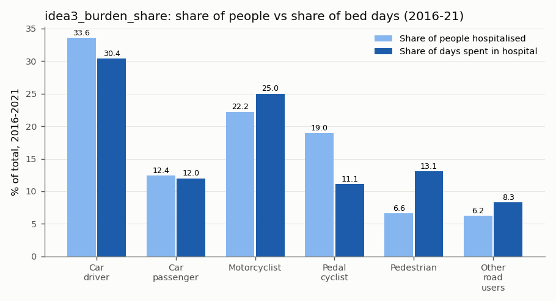
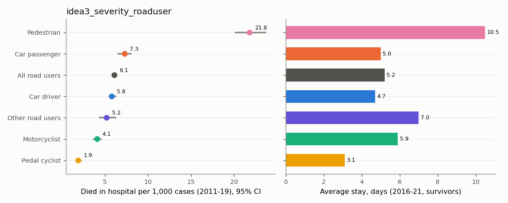
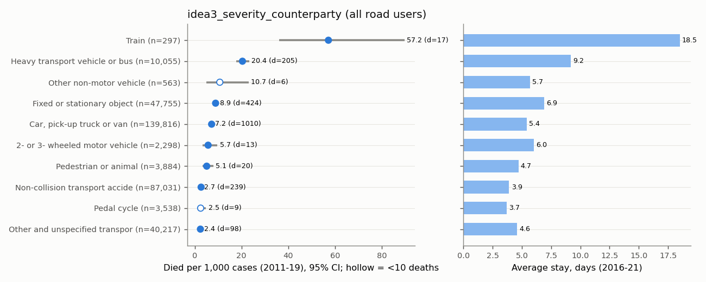
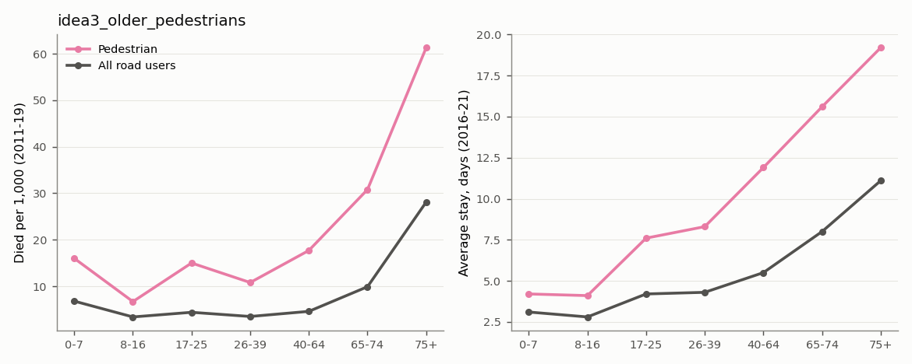
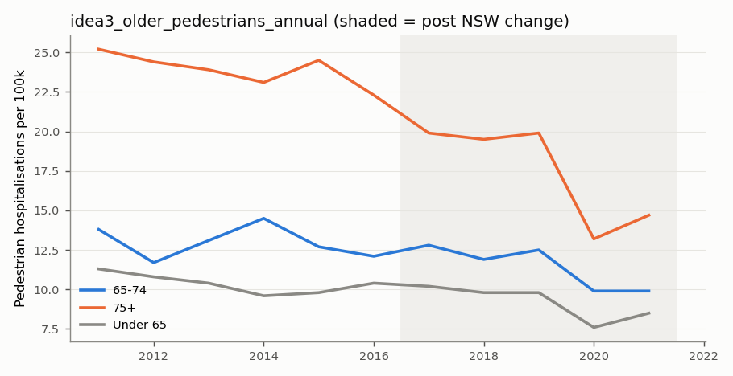
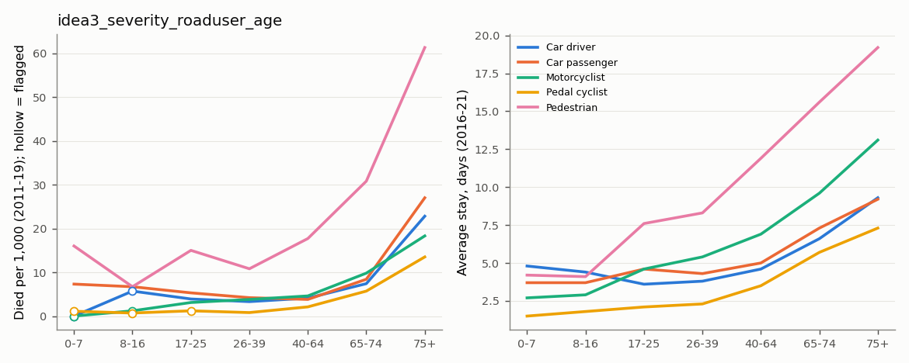

### Headline test

Working headline: *"Not every crash is equal: pedestrians are a small share of the injured but a large share of the harm."*

**Verdict: HOLDS, and the data make it stronger.** Pedestrians account for twice their share of bed days and 3.6 times their share of in-hospital deaths. Both comparisons hold within one consistent period each.

- **True version:** "Pedestrians are about 1 in 14 people hospitalised after a road crash, yet about 1 in 4 of those who die in hospital." (7.3% of cases vs 26.4% of in-hospital deaths, 2011-19)
- Alternative 1: "Pedestrians fill twice their share of hospital beds." (6.6% of cases, 13.1% of bed days, 2016-21)
- Alternative 2, for Sam's parents: "When an older pedestrian is hit, the odds turn sharply: 61 in every 1,000 people aged 75+ admitted after being hit never leave hospital." (2011-19)

**Do not say** older pedestrians are "more likely to be hit". Their hospitalisation rate per 100k fell (75+: 25.2 in 2011, 19.9 in 2019). Part of that fall comes from the NSW 2017 series break, and 2020-21 are lockdown-affected. The honest answer to Sam's question is **"less often hurt, far worse hurt"**: older pedestrians are hospitalised no more often than before, but the consequences are much more severe.

### Key numbers

1. Pedestrians: **7.3% of cases, 26.4% of in-hospital deaths** (2011-19); **6.6% of cases, 13.1% of bed days** (2016-21).
2. Died in care per 1,000: **pedestrian 21.8 vs car driver 5.8 vs cyclist 1.9** (2011-19), i.e. 3.8x and 11.5x.
3. Pedestrians aged 75+: **61.3 per 1,000 die in hospital** (2011-19). Average stay **19.2 days** (2016-21), vs 11.1 days for all 75+ road users.
4. Pedestrians 65+ are **22.9% of pedestrian cases but 51.7% of pedestrian in-hospital deaths**.
5. A heavy vehicle or bus is the deadliest thing to be hit by for every road user where a rate can be published. For pedestrians it is **52.7 per 1,000** (2011-19). Trains are worse (57.2 overall) but rare (297 cases in 9 years).

### Caveats to print next to each chart

- Burden chart: "Share of hospital cases and bed days, 2016-2021. Bed days were counted differently before July 2015. Counts, not risk per trip: we have no data on how far people walk, ride or drive."
- Severity chart: "Deaths in hospital within 30 days per 1,000 admitted, 2011-2019. 2020-21 death records are incomplete. This is the outcome once admitted, not the chance of dying on the road (most road deaths happen before hospital)."
- Counterparty chart: "Rates shown only where there are at least 100 cases and 10 deaths. Train figures rest on 17 deaths."
- Older pedestrians: "Per 1,000 admitted, not per head of population. Older people are more frail, so the same impact does more harm."

### Recommended charts (phone-first)

- **Main: paired horizontal bars ("two rankings")** with two bars per road user: share of people hospitalised and share of bed days (`idea3_burden_share.csv`, filter `measure`). Horizontal bars fit a 375px screen and long labels. The pedestrian bar doubling is the visual surprise. Add a third reveal step with the share of deaths (2011-19, from `idea3_severity_roaduser.csv`) as a scroll-triggered annotation.
- **Supporting: dot plot with CI whiskers, by age**, pedestrians vs all road users (`idea3_older_pedestrians.csv`, `age_level == "band"`). The line steps up to 61.3 at 75+, which answers "my parents" directly. A single-select toggle (died per 1,000 / average stay) keeps it to one axis. The counterparty table works as a small sorted dot list in a tooltip or drawer, using `*_publish` columns only. Note that the per-road-user counterparty view is thin: only 3-5 of 10 counterparties per road user pass the flags, so a free "pick any road user" explorer would mostly show blanks. Limit it to "All road users" and "Pedestrians".

## 5. Idea 4: "The lockdown test"

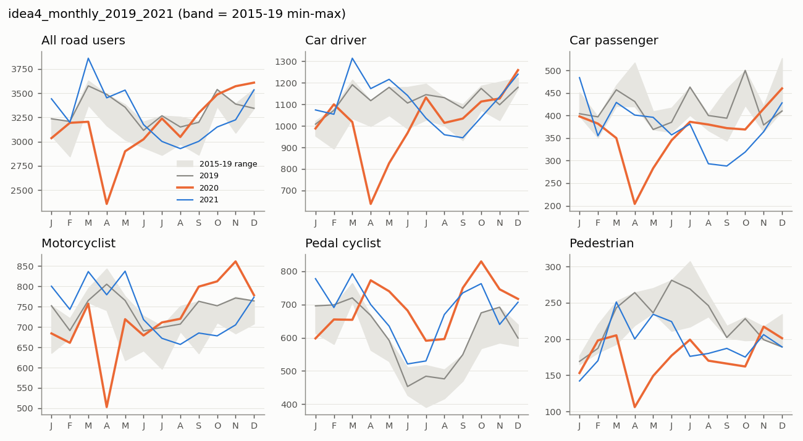
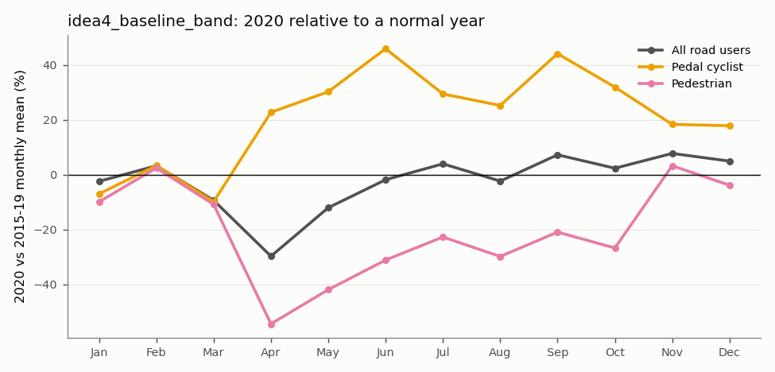
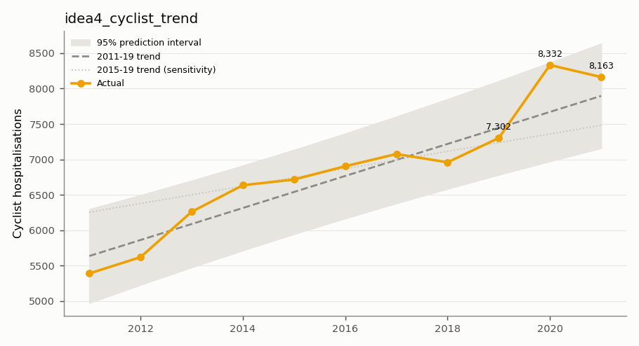
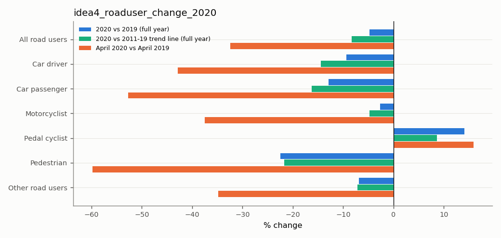
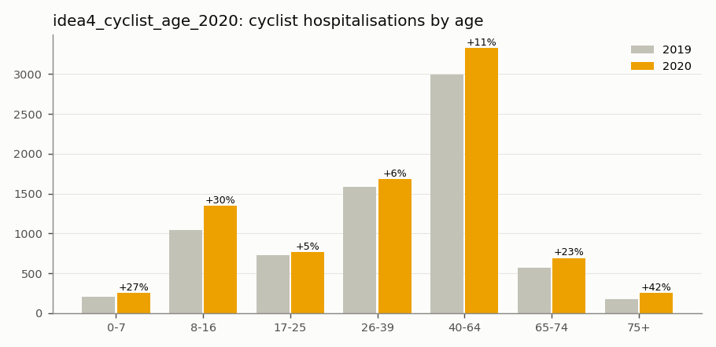
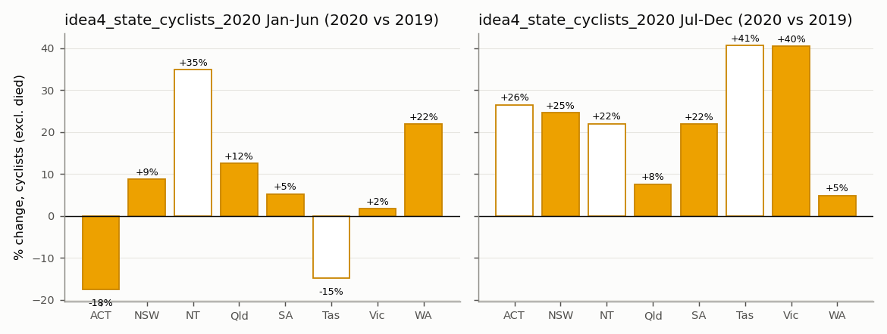

### Headline test

Working headline: *"The lockdown test: when the roads emptied in 2020, cycling injuries went up."*

**Verdict: HOLDS, with two edits.** (1) "The roads emptied" is not shown by this data: there is no traffic-volume series. Say "when Australia locked down". (2) "Went up" is true against 2019 (+14.1%) and the 2015-19 range (Apr-Dec every month above the maximum). Against the pre-existing upward trend, the annual rise is smaller: +8.6%, inside the 95% prediction interval of the 2011-19 fit. The monthly evidence is clearer: Apr-Dec was +17.4% above the trend-adjusted expectation, 9 of 9 months. So the rise was real and concentrated after March. Roughly a third of the annual rise (+368 of +1,030) is what the trend alone would have produced.

- **True version:** "In the month Australia locked down, crash admissions fell by a third. Cyclist admissions rose."
- Alternative 1: "Every road user went to hospital less in April 2020, except cyclists."
- Alternative 2: "From April to December 2020, cyclist admissions beat every month of the previous five years."

### Key numbers

1. April 2020: **2,357 admissions vs 3,488 in April 2019 (-32.4%)**, and 29.8% below the 2015-19 April average. This was the lowest month in 2011-2021.
2. Cyclists: **7,302 to 8,332 (+14.1%)**, 2019 to 2020. The only main road user to rise. Pedestrians fell 22.5%, car drivers 9.4%.
3. Cyclists, April-December 2020: **+23.9% on 2019**. Every month was above the 2015-19 maximum. June: **682 vs 453 (+50.6%)**.
4. Against the 2011-19 trend: **+662 admissions (+8.6%) above expectation** for 2020. The rise was already under way, and lockdown added to it.
5. Children 8-16 were 14.3% of 2019 cyclist cases but **29.8% of the 2020 rise** (1,041 to 1,348, +29.5%).

### Caveats to print next to each chart

- Monthly chart: "Lockdowns differed by state; Victoria's was longest. National monthly data cannot be split by state. Shaded band = range of 2015-2019."
- Cyclist chart: "We do not know how many more people were riding. The likely explanation is more riders, not more dangerous riding, but this data cannot prove it."
- Trend chart: "The trend line uses 2011-2019. The annual 2020 value sits above the line but within normal year-to-year variation; the monthly pattern after March is the stronger signal."
- State panel (if used): "Six-monthly, by state of residence (not crash location), excludes patients who died in hospital. NSW's 2017 definition change does not affect 2019 vs 2020. The timing fits Victoria's second lockdown (Jul-Dec 2020: Vic +40.5%, 51.8% of the national rise), but this data cannot prove the link."

### Recommended charts (phone-first)

- **Main: line chart with a baseline band**, cyclists only, Jan-Dec. Show the 2015-19 min-max band in grey, the 2015-19 mean as a thin line, 2019 as a muted line and 2020 in an accent colour (`idea4_baseline_band.csv`, `idea4_monthly_2019_2021.csv`). A band beats a single comparison year, and one road user per view stays legible at 375px. A step control switches between "All road users" (shows the April trough) and "Cyclists" (shows the rise). The two views share the same axes form but rescale.
- **Supporting: diverging horizontal bars** of % change April 2020 vs April 2019 by road user (`idea4_roaduser_change_2020.csv`, `comparison == "april_vs_2019"`). Five bars fall left and one rises right, so the twist is visible in a glance. The cyclist trend chart with its prediction band is best kept as an explanatory inset or methods figure.

## 6. Differences from HANDOFF / PHASE2_PLAN

| Claim | Status |
|---|---|
| June 2020 cyclists 683 | **Revise to 682** (683 is Count of cases). June 2019 = 453 is unchanged. +50.6% |
| Counterparty train 48.7 per 1,000, 14.5 days; heavy vehicle/bus 17.3, 8.4 days (HANDOFF §6) | **Revise:** train 57.2 per 1,000 (2011-19), 18.5 days (2016-21); heavy vehicle/bus 20.4, 9.2 days. The old figures pooled 2011-21 deaths and all-years bed days |
| HANDOFF §6 pooled pedestrian 19.3 / driver 4.9 / cyclist 1.6 | Superseded by 21.8 / 5.8 / 1.9 (2011-19), as already recorded in §3 |
| HANDOFF §6 April 2,369 / 3,507 | Superseded by 2,357 / 3,488 (already noted in §9) |
| Pedestrians -22%, car drivers -9% in 2020 | Confirmed: -22.5%, -9.4% |
| "Sharpest fall in the decade" (PHASE2_PLAN) | Confirmed: largest year-on-year monthly fall and lowest month in 2011-21 |
| "When the roads emptied" (PHASE2_PLAN) | Not supported by this data (no traffic volumes). Reword |
| Shares 6.6% / 13.1% etc. | Confirmed, but only with cases_incl_died as the denominator (Hospitalisations gives pedestrians 6.5%) |
