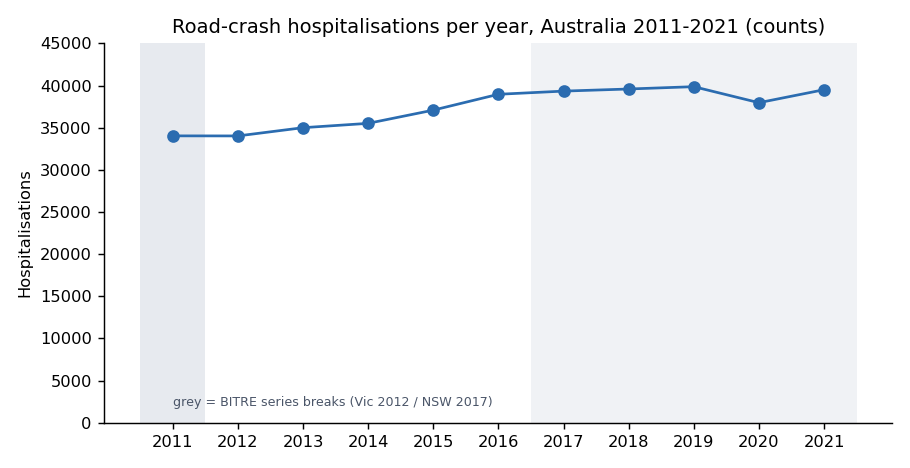
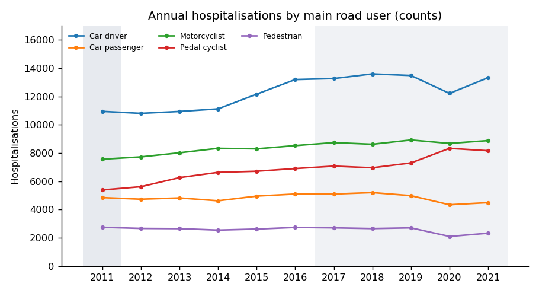
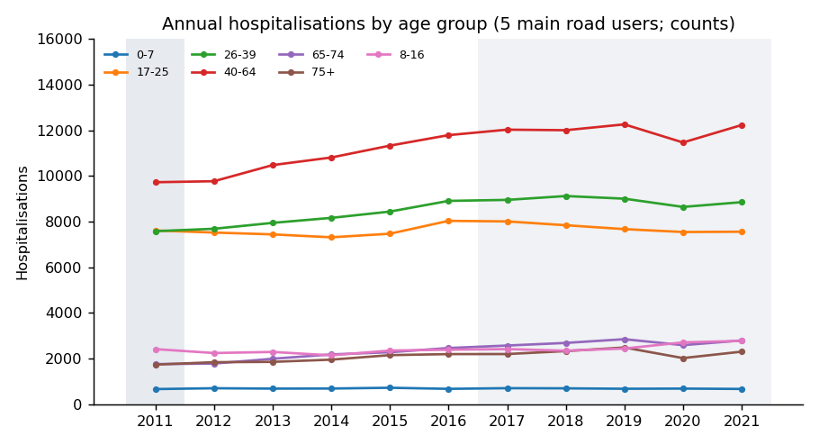
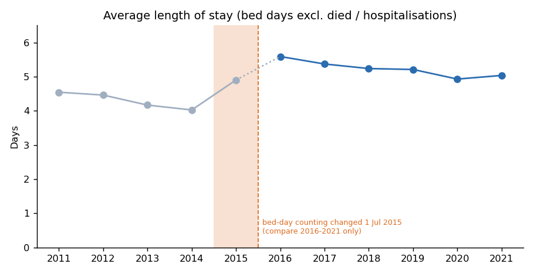

# Exploratory Data Analysis and Data-Processing Report

**Project:** COS30045 Assignment 3, hospitalised injuries from road crashes in Australia, 2011-2021
**Script:** `processing/clean_data.py` (single reproducible pipeline) with `processing/eda_figures.py` for the figures below
**Outputs:** `data/clean/*.csv`, `processing/validation_results.csv`, `processing/run_log.txt`

## 1. Sources and scope

| File (`Datas/`) | Used sheets | Role |
|---|---|---|
| `hospitalisation_injury_publication_sep2023.xlsx` (BITRE, national) | `raw` for all derivations; `T1`-`T4` for validation only | Primary data |
| `state-and-territory-hospitalisation-injury-publication-2023.xlsx` | `raw` (5 side-by-side blocks); `T1`, `T2`, `T4`, `T5` for validation only | Later chapters |
| `First-Nations-hospitalised-injuries-2023.xlsx` | `raw` (5 side-by-side blocks); `T1`-`T5` for validation only | Later chapters |
| `hospitalised-injury-data-dictionary-september-2023.pdf` | Definitions only | Documentation |

Scope: calendar years 2011-2021, hospital separations for injuries from road crashes. As the brief recommends, every aggregation is derived from the `raw` sheets. The published summary tables are used only to check the derivations (Section 6). No external data were used; population and road-death series will be added in a separate step.

**Counts, not rates.** All values are absolute counts of hospitalisations. They carry no exposure information (population, kilometres travelled, cycling participation) and must not be read as risk. Comparisons between groups of very different size (for example the Northern Territory and Victoria, or cyclists and car drivers) describe volume of hospital activity, not relative danger.

## 2. Processing steps (rule map)

| Rule | What the script does |
|---|---|
| R1 | Reads `raw` sheets only; T-tables are read in the `validate_*` functions only |
| R2 | Keeps `Cause of injury == "Traffic"` (dictionary category (a), road crash hospitalisations): 117,919 raw rows to **86,140** |
| R3 | `Hospitalisations` is the primary count (equals published T1-T3). `Count of cases` becomes `cases_incl_died`; `Died_cases` and `Died_bed_days` are kept for mortality |
| R4 | Whitespace trimmed. "Missing" and "intersex or indeterminate or missing" become "Unknown". Age bands ordered 0-7 ... 75+. `month` mapped to `month_num` 1-12 |
| R5 | NaN investigation (Section 4); zero-fill only where NaN provably means zero |
| R6 | `series_break`: 2011 = `pre_vic_2012_change`; 2017-2021 = `post_nsw_2017_change`; other years empty |
| R7 | Bed-day pairing test (Section 7); `bed_days_excl_died = bed_days - died_bed_days`; average stay restricted to 2016-2021 |
| R8 | `died_per_1000 = 1000 x died_cases / cases_incl_died`, 2011-2019 only |
| R9 | `low_count = True` where `hosp_2011 < 30` or `hosp_2021 < 30` |
| R10 | Validation against published tables (Section 6); mismatches are reported, never altered |
| R11 | Each state / First Nations side-by-side block is parsed into its own tidy CSV; "n.p." becomes empty plus `suppressed = True` |

## 3. Files, shapes, columns, types

**National `raw` sheet:** 117,919 rows x 13 columns (86,140 Traffic rows). Original dtypes: `Calendar year` int64; `Month`, `ABS remoteness area`, `Cause of injury`, `Age group`, `Sex`, `Road user`, `Counterparty` object; `Count of cases`, `Died_cases`, `Died_bed_days` float64 (because of NaN); `Bed days`, `Hospitalisations` int64. Six causes are present (Traffic 86,140; Medical events 8,405; All other trauma events 7,617; Non-traffic 6,086; Unknown traffic 5,554; Other transport 4,117).

**Clean outputs (`data/clean/`, UTF-8, snake_case, no index):**

| File | Shape | Columns |
|---|---|---|
| `traffic_national_monthly_clean.csv` | 86,140 x 15 | year, month_num, month, remoteness, age_group, sex, road_user, counterparty, hospitalisations, cases_incl_died, died_cases, bed_days, died_bed_days, bed_days_excl_died, series_break (all counts int; text otherwise) |
| `idea1_national_annual.csv` | 11 x 7 | year, hospitalisations, index_2011, cases_incl_died, died_cases, bed_days_excl_died, series_break |
| `idea1_national_monthly.csv` | 132 x 4 | year, month_num, date (YYYY-MM-01), hospitalisations |
| `idea2_roaduser_age_annual.csv` | 385 x 4 | road_user, age_group, year, hospitalisations (5 road users x 7 ages x 11 years; absent combinations = 0) |
| `idea2_heatmap_change.csv` | 35 x 10 | road_user, age_group, hosp_2011, hosp_2021, abs_change, pct_change, avg_2011_2013, avg_2019_2021, pct_change_3yr, low_count |
| `idea2_age_severity.csv` | 7 x 7 | age_group, hosp_2016_2021, bed_days_excl_died_2016_2021, avg_stay_days_2016_2021, cases_2011_2019, died_2011_2019, died_per_1000_2011_2019 |
| `state_by_state / by_road_user / by_sex / by_age / by_counterparty.csv` | 176 / 1,371 / 352 / 1,232 / 704 rows | year, half_year, [dimension], cases_excl_died, bed_days_excl_died, state, suppressed |
| `first_nations_by_age / by_road_user / by_age_2 / by_remoteness / by_counterparty.csv` | 264 / 351 / 264 / 132 / 176 rows | year, half_year, first_nations_status, [dimension], hospitalisations, bed_days_excl_died, suppressed |

Counts in the state and First Nations files exclude patients who died in hospital within 30 days, and the state road-user categories are aggregated (car driver, passenger and unknown position are merged; heavy transport roles are merged). The constant `cause of injury = traffic` column is dropped after being asserted. Numeric columns in these files are nullable integers.

## 4. Missing values (R5)

Within the Traffic subset:

| Column | NaN rows | Interpretation | Action |
|---|---|---|---|
| Count of cases | 4,578 | Every one of these rows has `Hospitalisations = 0` and `Died_cases = NaN`; no case was counted | 0 |
| Died_cases | 84,142 | Where `Died_cases` is NaN and a case count exists, `Count of cases == Hospitalisations` (0 violations), i.e. no deaths in the cell. Where present, `cases = hospitalisations + died_cases` holds with 0 violations | 0 |
| Died_bed_days | 83,854 | No died bed days where there were no deaths (zero NaN where `Died_cases` is present) | 0 |
| Bed days, Hospitalisations | 0 | | none |

After the fills, `cases_incl_died == hospitalisations + died_cases` holds on all 86,140 rows (validated), and no row has `bed_days < died_bed_days`.

Two features are kept as published and flagged rather than corrected:

* **4,899 Traffic rows have `Hospitalisations = 0`.** 4,578 have no case count at all but carry positive bed days (90,405 in total, 4.5% of all Traffic bed days); the remainder are cells with died cases only. Dropping these rows would put the state and First Nations bed-day totals above the national total (for example 2016: 205,664 vs the First Nations file's 214,065), so the published totals do include them. They have no effect on any count; they add to bed days and therefore to average stay.
  * *Why these rows exist (data dictionary, "Bed days"):* when a patient is transferred between hospitals, only the first separation counts as a case, but bed days from both periods of care are counted. If the second separation ends in a later month, that month records bed days with no case. These rows are legitimate and are retained.
* 288 rows have `Died_bed_days` but no `Died_cases`. They are zero-filled for `died_cases` and the bed days are retained.

**Unknown categories (share of Traffic hospitalisations):** remoteness Unknown 2.15% (8,833); age Unknown 1 case; sex Unknown 15 cases; road user "Other or unknown" 1.54% and "Car unknown position" 2.15% (kept as published categories). Unknown age and unknown sex are therefore negligible.

## 5. Category values and counts (Traffic, 2011-2021 pooled, Hospitalisations)

| Road user | Hospitalisations | Share |
|---|---|---|
| Car driver | 135,063 | 32.9% |
| Motorcyclist | 92,322 | 22.5% |
| Pedal cyclist | 75,362 | 18.3% |
| Car passenger | 53,241 | 13.0% |
| Pedestrian | 28,532 | 6.9% |
| Car unknown position | 8,836 | 2.2% |
| Other or unknown | 6,346 | 1.5% |
| Heavy transport driver / passenger / unknown position | 4,614 / 553 / 444 | 1.1% / 0.1% / 0.1% |
| Pick-up truck or van occupant | 2,987 | 0.7% |
| Bus occupant | 2,584 | 0.6% |

| Age group | Share | Remoteness | Share | Sex | Share |
|---|---|---|---|---|---|
| 40-64 | 32.6% | Major Cities | 66.1% | Male | 64.9% |
| 26-39 | 24.2% | Regional | 28.7% | Female | 35.1% |
| 17-25 | 21.6% | Remote | 3.1% | Unknown | 0.0% |
| 65-74 | 6.8% | Unknown | 2.2% | | |
| 8-16 | 6.7% | | | | |
| 75+ | 6.1% | | | | |
| 0-7 | 2.0% | | | | |

Counterparty (share): car/pick-up/van 41.3%; non-collision 26.4%; fixed object 14.3%; other/unspecified 12.0%; heavy vehicle or bus 2.9%; pedestrian or animal 1.2%; pedal cycle 1.1%; 2/3-wheeled motor vehicle 0.7%; other non-motor 0.2%; train 0.1%. The Idea 2 grid keeps the 5 main road users and the 7 known age bands: 384,520 of 410,884 hospitalisations (93.6%); the remainder are other road users or unknown age.

## 6. Validation results (R10)

All derived tables were compared with the published summary tables. Full detail: `processing/validation_results.csv`. Result: **18 PASS, 9 FAIL, 0 unexplained**. Every FAIL is a mismatch between the tidy export and a published total that has a documented cause; no value was altered to make a check pass.

| Check | Result |
|---|---|
| National annual total vs T1 (11 years) | PASS (exact) |
| Road user x year vs T2 (12 categories + total) | PASS (exact) |
| Age group x year vs T3 (7 bands + Unknown + total) | PASS (exact) |
| Remoteness x year vs T4 ("Missing" = "Other or unknown") | PASS (exact) |
| `cases_incl_died = hospitalisations + died_cases` on every row | PASS |
| State x year (8 states) vs state T1 | PASS (exact) |
| State `by_counterparty` vs state T5 totals and vs T1 | PASS |
| State `by_road_user` vs T2 totals / T1; `by_age` vs T4 totals / T1 | FAIL (explained): n.p. cells (185 and 80 rows) are empty in the tidy export but included in the published state totals; the shortfall appears only in state-years that contain n.p. cells (max 37 and 55 cases) |
| State `by_sex` vs T1 | FAIL (explained): block contains Male/Female only; max shortfall 3 cases per state-year |
| First Nations `by_counterparty` vs T1; all four blocks vs their T2-T5 totals | PASS (exact) |
| First Nations `by_age` (and duplicate `by_age_2`) vs T1 | FAIL (explained): 2014 only, where n.p. cells exist |
| First Nations `by_road_user` vs T1 | FAIL (explained): n.p. cells (62 rows) |
| First Nations `by_remoteness` vs T1 | FAIL (explained): block excludes unknown remoteness; matches FN T4 exactly |
| Sanity: 2011 = 34,033; 2021 = 39,505; cyclist 65-74 +212%, 75+ +228%; motorcyclist 65-74 +150% | PASS |

Informational: the eight states sum to 470-997 fewer cases per year than the T1 "Australia" column because that column also includes residents whose state is unknown. **First Nations blocks 1 and 3 (both "by age") are exact duplicates**, so `first_nations_by_age_2.csv` can be ignored. First Nations blocks cover people with a recorded Indigenous status only (about 1.2-2.6% of national cases are outside them), so they do not reach the national total.

## 7. Bed-day pairing test (R7)

**Question:** does national `Bed days` already include `Died_bed_days`? The state and First Nations files report "bed days excluding died in hospitals within 30 days".

**Method:** the external files cover about 97.5-98.8% of national cases (residents with unknown state or Indigenous status are absent). If a national bed-day series is on the same basis as the external files, the external bed-day coverage should equal the external case coverage. For each year with died bed days (2011-2020) the script computes the gap (bed-day coverage minus case coverage) under each pairing: plain `Bed days`, and `Bed days - Died_bed_days`.

**Result:**

| External file | Mean abs. gap, plain `Bed days` | Mean abs. gap, `Bed days - Died_bed_days` |
|---|---|---|
| State (`by_state`) | 0.67 pp | **0.26 pp** |
| First Nations (`by_counterparty`, no n.p. cells) | 1.23 pp | **0.60 pp** |

The excluded-died pairing is closer in 18 of 20 file-years (the exceptions are the state file in 2019 and 2020). Plain `Bed days` is systematically too large by roughly the died share (0.3-0.9%), which is the signature of national `Bed days` **including** died-in-hospital bed days. In 2021, when `Died_bed_days = 0`, the two pairings coincide. **Decision:** `bed_days_excl_died = bed_days - died_bed_days` and `avg_stay_days = bed_days_excl_died / hospitalisations`. The test is not exact because the external files omit unlocated cases; it supports the pairing but does not prove it.

**Effect on earlier figures (2016-2021 average stay):** negligible. Old method (Bed days / Hospitalisations) vs new: 75+ 11.2 vs **11.1**; every other age group is unchanged at one decimal (65-74 8.0; 40-64 5.5; 26-39 4.3; 17-25 4.2; 0-7 3.1; 8-16 2.8). Mortality figures are unaffected (75+ 28.1 per 1,000).

## 8. Anomalies

* **Deaths in care, 2020-2021.** `Died_cases`: 261, 246, 216, 214, 243, 268, 202, 197, 194 (2011-2019), then **88 (2020)** and **0 (2021)**, so 2021 `cases_incl_died` equals `hospitalisations`. This looks like incomplete death linkage, not a real fall; mortality analysis is limited to 2011-2019 (R8).
* **Average stay jump 2015-2016.** Bed days excl. died per hospitalisation: 4.54, 4.46, 4.17, 4.03 (2011-2014), 4.90 (2015), **5.59 (2016)**, then 5.37, 5.24, 5.21, 4.93, 5.04. The method changed on 1 July 2015 (ICD-10-AM 9th edition, rehabilitation rule), so bed-day comparisons use 2016-2021 only (R7).
* **Series breaks (R6).** Victoria stopped counting emergency-department-only cases from 2012 (about -2.8% nationally in 2012) and NSW did so from June 2017. Both narrow the definition and lower counts, so the national rise is probably understated and NSW's post-2017 fall is an artefact (NSW 11,474 in 2016 to 9,003 in 2021).
* **n.p. suppression.** State road-user block: 185 of 1,371 rows (13.5%) in ACT, NT, SA, Tas and WA. State age block: 80 of 1,232 (6.5%) in ACT, NT, Tas. First Nations road-user block: 62 of 351 (17.7%); age block: 4 of 264. State by_state, by_sex, by_counterparty, and First Nations remoteness and counterparty blocks have none.
* **Zero-hospitalisation rows with bed days** (Section 4).
* **First Nations 2014 age block:** n.p. suppression means the 2014 block total is understated (32,192 vs 34,817 published).

## 9. Key descriptive findings

**Idea 1 (hidden road toll).**
* Hospitalisations rose from 34,033 (2011) to 39,505 (2021), +16.1% (index 116.1); peak 39,866 in 2019; 2020 fell to 37,966 (-4.8%). In 2021 that is 108 people a day.
* Deaths in care cannot support a trend (Section 8), so the "deaths fell" contrast needs the external BITRE road-death series (later step).
* April 2020 had 2,357 hospitalisations vs 3,488 in April 2019 (-32.4%). (The HANDOFF figures of 2,369 and 3,507 used `Count of cases`, which includes died cases.)
* Pedal cyclists rose 5,391 to 8,163 (+51.4%) and car drivers +21.7%, motorcyclists +17.4%, while car passengers fell 7.4% and pedestrians 15.3%.

**Idea 2 (older, longer, more serious).**
* Cyclists aged 65-74: 240 to 749 (+212.1%); 75+: 87 to 285 (+227.6%); 40-64: +68.2%. Motorcyclists 65-74: +149.7%, 75+: +166.7%. Using three-year averages (2011-13 vs 2019-21) the same cells remain the largest rises (+138%, +142%, +119%, +105%), so the pattern is not an artefact of two end years.
* Two cells fall below 30 (`low_count`): car driver 0-7 (0 to 9; percentage change left empty) and motorcyclist 0-7 (27 to 36).
* Average stay 2016-2021: 75+ 11.1 days, 65-74 8.0, 40-64 5.5, 26-39 4.3, 17-25 4.2, 0-7 3.1, 8-16 2.8. Over-75s stay about 2.6 times as long as 26-39 year olds.
* Died in care per 1,000 cases 2011-2019: 75+ 28.1; 65-74 9.9; 26-39 3.5 (8 times lower than 75+).

## 10. Limitations

* **Counts, not rates.** No population or exposure data are included. A rise in counts can reflect population growth (notably in the over-65 group), more cycling, or better recording, and cannot be read as higher individual risk.
* **No exposure.** Kilometres travelled, trips and cycling participation are unavailable, so risk per trip cannot be compared across road users.
* **Residence is not crash location.** State and remoteness refer to the patient's usual residence.
* **Series breaks** (Vic 2012, NSW 2017) and the **2015 bed-day method change** limit year-to-year comparison, as set out above.
* **Mortality** reflects deaths in hospital within 30 days only and is unreliable after 2019.
* **Suppression and aggregation** in the state and First Nations files (n.p. cells, merged road-user categories, 65+ merged for First Nations) limit detailed breakdowns. First Nations trends may partly reflect improved Indigenous identification.
* **Zero-hospitalisation bed days** (4.5% of bed days) are retained as published and are unexplained in the dictionary.

## Supplementary data (population and road deaths)

**Sources** (full citations in `data/supplementary/SOURCES.md`): ABS Estimated Resident Population, dataflow `ABS:ERP_Q` (Data API, persons, Australia, Q2 = 30 June, single year of age 0-100+), and BITRE Australian Road Deaths Database `ardd_fatalities.csv` (Oct 2023 snapshot, via data.gov.au). Accessed 2026-11-17. Raw files: `data/supplementary/raw/`. Script: `processing/supplementary_data.py` (no network use).

**Method.** Single-year ERP was summed into the BITRE bands (0-7, 8-16, 17-25, 26-39, 40-64, 65-74, 75+); band sums reconcile exactly with the ABS total each year. Road deaths = ARDD rows per `Year`. Rates = hospitalisations (BITRE `Hospitalisations`, from `idea1_national_annual.csv`) / ERP x 100,000. Note: the ABS series is the current revised series; ERP at 30 June 2011 is 22,340,024 and 2021 is 25,685,412. The ABS population is all residents and the hospitalisation counts follow the BITRE series breaks (Vic 2012, NSW 2017), so rate trends after 2017 are also slightly understated.

**Outputs:** `supp_population_annual.csv`, `supp_population_age.csv`, `supp_road_deaths_annual.csv`, `idea1_rates.csv`, `idea1_index_long.csv`, `idea2_age_population_change.csv`.

**Verification of earlier claims**

| Claim | Status |
|---|---|
| Population +15%, 22.3m to 25.7m | CONFIRMED (+14.97%; 22,340,024 to 25,685,412) |
| Hospitalisation rate about 153 per 100k in 2011 and 2021 | CONFIRMED, approximately: 152.3 (2011), 153.8 (2021); peak 161.1 in 2016. Note: the series breaks mean the true rate rise is somewhat understated |
| Road deaths 1,277 to 1,127, about -12%, per capita about -23% | REVISED: 1,277 to 1,130 (-11.5%); per capita 5.72 to 4.40 per 100k (-23.1%) |
| About 35 hospitalised per death in 2021 | CONFIRMED (35.0; it was 26.7 in 2011) |
| 65+ population +40% | CONFIRMED (+39.7% combined); 65-74 +44.3%, 75+ +34.2% (single-year); on 3-year averages +33.4% and +26.1% |
| Cyclist 65+ rise far larger than population growth | CONFIRMED but smaller than the raw counts suggest. Per-100k rate, Pedal cyclist 65-74: 14.3 to 30.9 (+116%, single-year), 15.9 to 28.3 (+78%, 3-yr avg). 75+: 6.2 to 15.1 (+144% single), 6.9 to 13.2 (+92% 3-yr). Counts rose +138%/+142% (3-yr) while the population rose +33%/+26%, so the rate roughly doubled but is not "x2.4". "More than doubled" holds for counts; for rates use "nearly doubled" (+78% to +92%) on 3-yr averages. |
